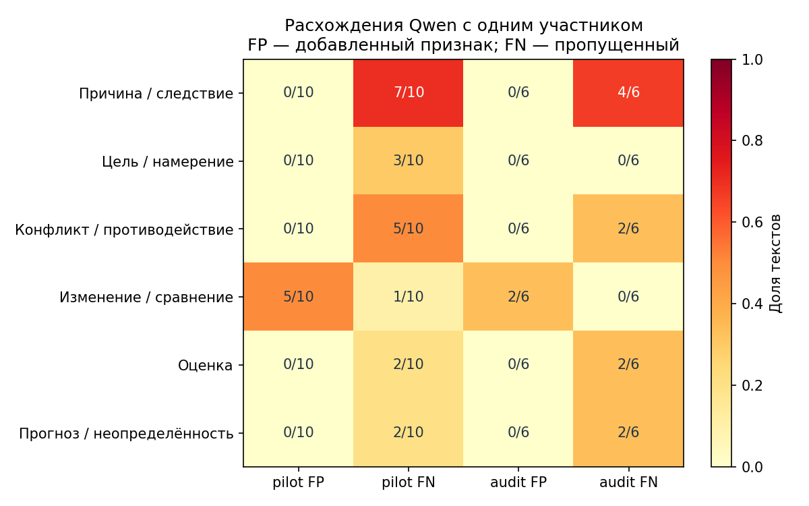

# Смысловые связи в русских новостях

Сравнение человеческой разметки и ответов локальной Qwen3.5 9B на корпусе Gazeta. Задача исследования — выяснить, какие смыслы человек и модель выделяют в одних и тех же текстах, в чём расходятся их интерпретации и повторяются ли эти расхождения на новом материале.

Основной файл — [experiment.ipynb](experiment.ipynb). В нём сохранены код, пояснения к методу, таблицы и графики. Подробные результаты находятся в [отчёте](results/REPORT.md).

## Материал и метод

Используются **1000 русских редакционных аннотаций** из [Gazeta](https://github.com/IlyaGusev/gazeta), поле `summary`. Полные статьи и заголовки на вход модели и участника не подаются.

Из выборки случайно выделены 10 пилотных текстов. Один участник независимо записал их главные смысловые связи и отметил признаки. Модель обработала эти же тексты и остальные 990. Для дополнительной проверки были отложены 20 новых текстов; завершена разметка **6 из 20**. Незавершённые ответы исключены из расчётов.

Смысл представлен в двух формах:

- **Связи** вида «субъект → отношение → объект». Человек мог выделить от одной до трёх главных связей, модель — до двух. После первичной разметки участник сопоставил связи по смыслу и оценил их подтверждение текстом.
- **Шесть признаков:** причина, цель, конфликт, изменение или сравнение, оценка, прогноз или неопределённость. Один текст может содержать несколько признаков.

Модель выбирает номер фрагмента-основания, а программа подставляет исходную цитату. Наличие цитаты подтверждает её происхождение, но само по себе не доказывает правильность связи.

Для сравнения используются TF–IDF биграмм и триграмм и простой словарь маркеров шести признаков. Порядок исследования описан в [PROTOCOL.md](PROTOCOL.md), корпус и литература — в [SOURCE.md](SOURCE.md).

## Основные результаты

Qwen обработала **1000 текстов** и выделила **1721 связь**. Пилот выполнен трижды с одинаковыми настройками; наборы признаков и точные формулировки связей совпали во всех трёх прогонах.

### Смысловые связи на 10 пилотных текстах

| Показатель | Результат |
|---|---:|
| Связи человека | 27 |
| Связи модели | 17 |
| Смысловые совпадения | 14 |
| Precision | 0,824 |
| Recall | 0,519 |
| F1 | 0,636 |
| Машинные связи, подтверждённые текстом по оценке участника | 17 из 17 |

Модель передала значительную часть выбранных человеком отношений, но охватила не все его связи. На полноту влияет и разный предел числа связей у человека и модели.

### Шесть смысловых признаков

| Выборка | Qwen micro-F1 | Словарный метод micro-F1 |
|---|---:|---:|
| Пилот, 10 текстов | 0,324 | 0,353 |
| Дополнительная проверка, 6 текстов | 0,400 | 0,300 |

Micro-F1 объединяет precision и recall по всем положительным решениям. Это не доля правильно понятых текстов. На пилоте 95% bootstrap-интервал Qwen составляет 0,114–0,537; малый объём разметки не позволяет установить надёжное преимущество над словарём.



*FP — признак, добавленный моделью относительно разметки участника; FN — пропущенный признак. В ячейках указано число текстов, а не число связей.*

В дополнительной проверке повторились **5 из 7 направлений расхождений** пилота. Например, причина не отмечена в 7 из 10 пилотных и в 4 из 6 новых текстов; изменение или сравнение добавлено в 5 из 10 и в 2 из 6 соответственно.

После анализа пилота проверена согласованность двух частей машинного ответа. В 36 из 59 текстов остальной выборки с явным причинным оборотом в поле отношения отсутствует признак `cause`. Это дополнительный анализ, сформулированный после просмотра пилота.

## Выводы и ограничения

Графы связей и перечень смысловых признаков дают разные результаты: причинность может присутствовать в самой связи, но отсутствовать среди меток. Поэтому совпадение признаков не исчерпывает оценку смыслового представления. Повторяемость генерации также не гарантирует правильность интерпретации.

Результаты относятся к одному участнику, коротким новостным аннотациям и небольшой проверенной части выборки. Аудит неполный: 6 завершённых текстов не образуют независимую репрезентативную оценку всех 990. Расхождения наблюдаются повторно, но их постоянство на всём корпусе не доказано. Человеческая разметка тоже допускает спорные трактовки. Дополнительные ограничения — двухступенчатый отбор страниц, разный предел числа связей и возможное присутствие Gazeta в предобучении модели.

## Запуск

Проверено на Python 3.10.10. Версии библиотек сохранены в [environment_versions.json](environment_versions.json).

```bash
python -m pip install -r requirements.txt
python execute_notebook.py
python -m unittest discover -s tests -v
python validate_project.py
```

Команды запускаются из корня репозитория. Ноутбук можно открыть в VS Code или Jupyter и выполнить по ячейкам. По умолчанию `RUN_INFERENCE=False`: используются включённые в репозиторий ответы, поэтому для просмотра и пересчёта результатов сервер модели не нужен.

Для продолжения машинной обработки требуется LM Studio с моделью `qwen/qwen3.5-9b` на `http://127.0.0.1:1234`:

```bash
python experiment.py predict --repeats
```

Параметры: `temperature=0`, `reasoning_effort=none`, JSON Schema, до 650 выходных токенов. Кэш проверяется по тексту и хешу протокола. Промпт сохранён в [results/protocol.json](results/protocol.json).

Дополнительные команды:

```bash
python experiment.py report
python experiment.py forms
```

Первая обновляет отчёт и графики; вторая создаёт локальные формы разметки и демонстрацию. Для просмотра смысловых графов нужно скачать [HTML демонстрацию](results/03_demo_after_annotation.html) и открыть её в браузере: GitHub не исполняет такой файл как веб-страницу.

## Структура репозитория

| Путь | Содержимое |
|---|---|
| [experiment.ipynb](experiment.ipynb) | Ноутбук с выполненными ячейками |
| `experiment.py` | Отбор данных, запросы к модели, сравнение и отчёт |
| `forms.py` | Формы разметки и визуализация связей |
| `build_notebook.py` | Сборка ноутбука из вычислительного кода |
| `execute_notebook.py`, `validate_project.py` | Исполнение и проверка результатов |
| `data/processed/corpus.jsonl` | 1000 аннотаций и разделение выборки |
| `data/manifest.json` | Источник, параметры отбора и контрольная сумма |
| `annotation/raw` | Исходные ответы участника |
| `annotation/imported` | Проверенная разметка и сопоставление связей |
| `results/predictions.jsonl` | Основной прогон по 1000 текстам |
| `results/cache`, `results/raw_responses` | Разобранные и исходные ответы, включая повторы пилота |
| `results/*.csv`, `results/summary.json` | Таблицы и показатели |
| `results/figures` | Графики |
| `tests` | Проверки данных, импорта и расчётов |

Сохранённые ответы позволяют пересчитать результаты без повторного запуска Qwen. Исходные страницы с полными статьями, временные файлы и отладочные пробы в репозиторий не включены. Права и условия использования корпуса указаны в [SOURCE.md](SOURCE.md).
