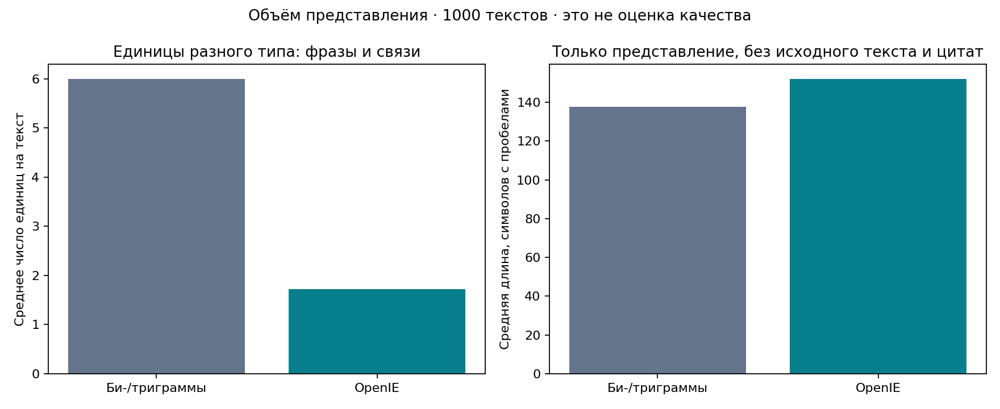
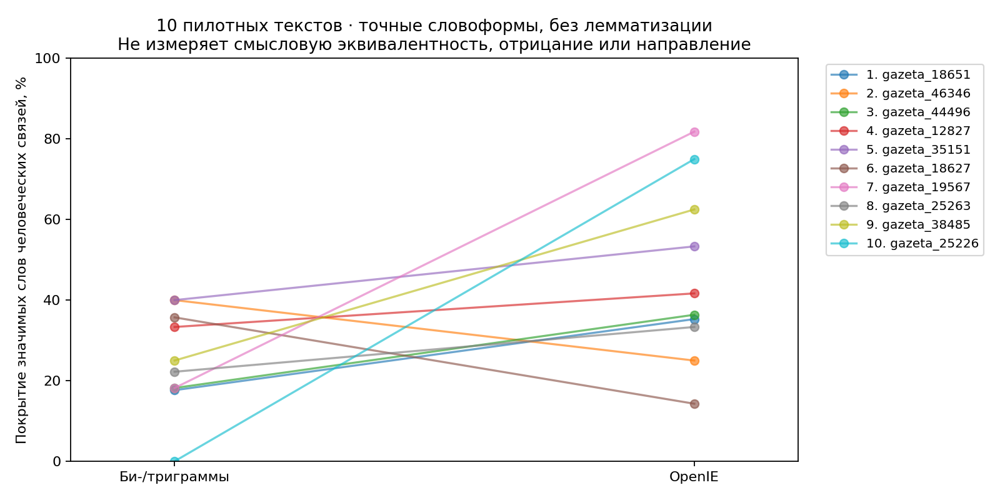
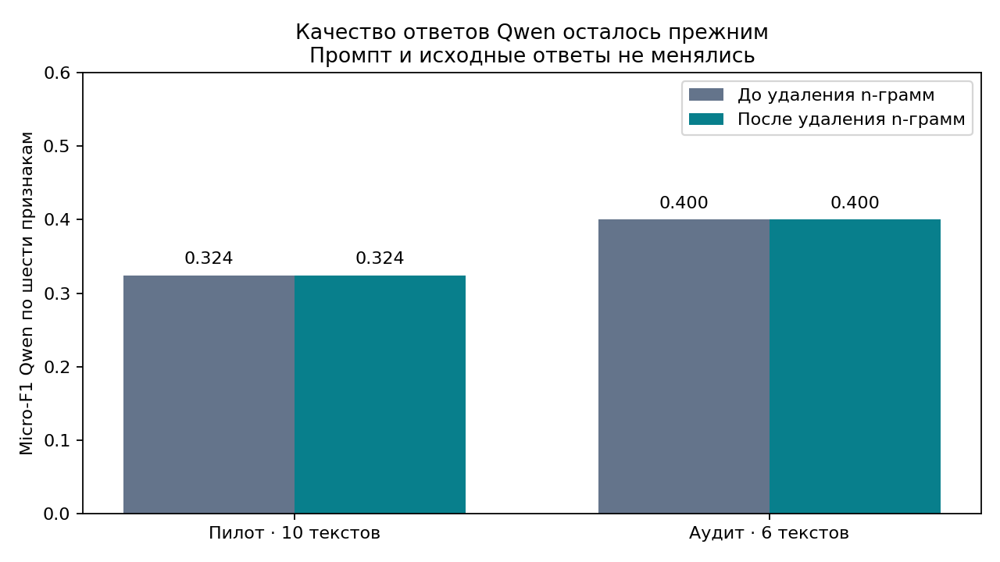

# Би-/триграммы и OpenIE: сравнение

## Что проверено

Одна выборка: 1000 редакционных аннотаций Gazeta. Для каждого текста восстановлены прежние 6 лучших би-/триграмм TF–IDF и взяты сохранённые OpenIE-связи Qwen. Параметры TF–IDF и фильтр крайних стоп-слов повторяют прежнюю реализацию; файл `ngrams.jsonl` позволяет проверить восстановление по SHA-256. Дополнительных запросов к модели нет.

**Качество ответов Qwen после удаления n-грамм не изменилось:** сами ответы и промпт остались прежними. Сравниваются два представления одного текста, а не две версии модели. Шесть бинарных признаков составляют отдельную задачу.

## Измеренные различия

| Показатель | Би-/триграммы | OpenIE |
|---|---:|---:|
| Текстов | 1000 | 1000 |
| Текстов с непустым представлением | 1000 | 999 |
| Единиц представления | 5994 сочетаний | 1721 связей |
| Средняя длина представления, символов | 137.5 | 151.9 |
| Среднее покрытие слов человеческих связей, 10 текстов | 25.0% | 45.9% |
| Ручное смысловое сопоставление | Не проводилось | 14 совпадений; precision 82,4%, recall 51,9%, F1 0,636 |

Число фраз и число связей относятся к разным единицам. Более длинное представление не обязательно лучше.

## Покрытие слов человеческой разметки

Для каждого пилотного текста объединяются значимые слова всех человеческих связей. Считается доля этих слов, присутствующих в представлении. Регистр и «ё/е» нормализуются, стоп-слова исключаются; лемматизации нет. В OpenIE учитываются только субъект, отношение и объект — исходный текст и цитаты исключены. Среднее считается по текстам, а не по всем словам сразу.

Разность OpenIE − n-граммы: **+20.8 процентного пункта**; парный bootstrap 95% по 10 текстам, 2000 повторов: [+3.7; +38.4] п. п. OpenIE выше в 8 текстах, n-граммы — в 2, равенство — в 0.

Это лексическая диагностика, **не семантическая точность**: перефразирование снижает совпадение слов, а одинаковые слова могут передавать разные утверждения. Направление, отрицание и авторство этой метрикой не проверяются. Выборка мала, один участник.

## Качество ответов до и после

| Оценка Qwen | До | После | Разность |
|---|---:|---:|---:|
| Micro-F1 признаков, пилот 10 текстов | 0.324 | 0.324 | 0 |
| Micro-F1 признаков, аудит 6 текстов | 0.400 | 0.400 | 0 |
| F1 смысловых связей, пилот | 0,636 | 0,636 | 0 |

Это проверка сохранения результатов, а не независимый эксперимент «до/после». Словарный метод нельзя считать показателем качества n-грамм: он отдельно определяет шесть признаков.

## Время

Построение TF–IDF и отбор фраз для 1000 текстов из памяти: медиана **0.174 с**, 4 замера. Формирование OpenIE-записей из уже готовых ответов в памяти: **0.036 с**, 3 замера. Сохранение файлов и чтение кэша не включены. Это стоимость обработки готовых данных, а не полного извлечения моделью.

Сумма сохранённых времён первоначальных запросов Qwen по 1000 текстам: **1303.4 с (21.7 мин)**. Время историческое, включает совместное извлечение связей и признаков; оно не является отдельным замером только OpenIE. Новый полный прогон для сравнения скорости не выполнялся. Удаление TF–IDF убирает небольшой дополнительный этап, но не ускоряет саму генерацию Qwen.

## Вывод

OpenIE явно представляет участников и отношение между ними и позволяет сопоставить связи с человеческими; n-граммы показывают лексические сочетания. При этом текущая переработка не улучшила ответы модели: отношения уже извлекались ранее. Новое сравнение показывает различие представлений и неизменность измеренного качества. Для доказательства преимущества одного представления по понятности нужна единая человеческая оценка обоих вариантов; такой оценки в имеющихся данных нет.

Все 10 примеров представлены рядом в `comparison.html` (открывается локально без интернета). Данные: `per_document.csv`, `human_word_coverage.csv`, `statistics.json`. Воспроизведение из корня проекта: `python compare_methods.py`.
